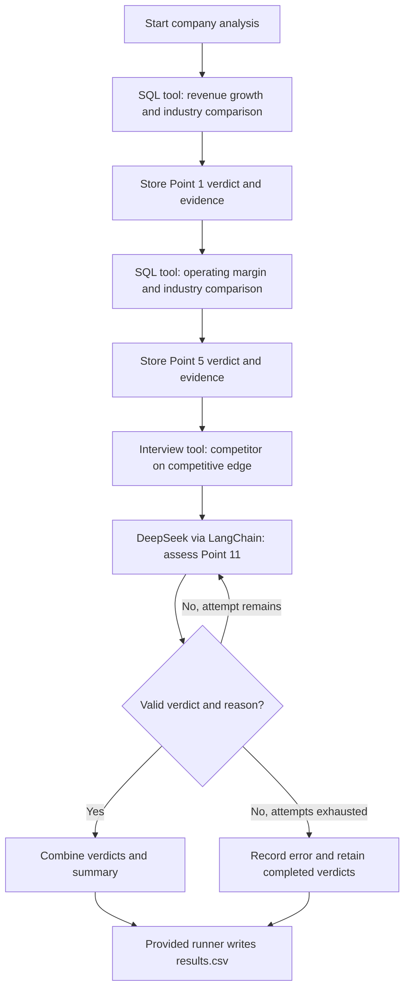

# FTEC5660 Homework 3: Fisher's 15-Point Investment Agent

Build a LangChain agent that researches a company with tools and applies the
framework from Philip Fisher's *Common Stocks and Uncommon Profits* (Part One,
Chapter 3 "What to buy: the fifteen points to look for in a common stock", and
Chapter 4 "What to buy: applying this to your own needs"). You choose 3 of
Fisher's 15 points and decide yourself what PASS means for each. For every
company your agent gives a PASS/FAIL verdict on your 3 points and a short
summary.

The companies are fictional, so the model cannot answer from memory. Unlike a
pile of reports, the evidence is spread over three sources, and your agent has
to go and get it with tools, the way Fisher's "scuttlebutt" method sends an
investor to talk to customers, competitors, suppliers and staff.

## Data and tools

`public_test/` has one folder per company. Your code receives four tools per
company (built by the provided code in `hw3.py`):

| Tool | What it gives you |
| --- | --- |
| `list_documents()` | the company's six documents and their dates |
| `read_document(name)` | one document: the 2025 letter to shareholders, four earnings calls (Q3 2025 to Q2 2026) and a news file (July 2025 to July 2026) |
| `sql_query(query)` | one read-only SQLite query on the company's database; at most 50 rows come back, so use `SUM`, `GROUP BY` and `WHERE` |
| `interview(role, topic)` | what one person says about the company; at most **10 interviews per company** |

The documents are what management says. Management's own claims (such as "we
have never cut research" or "our people are our greatest strength") are not
evidence on their own: check them against the database and the interviews.

**Database tables** (amounts in USD thousands; dates `YYYY-MM-DD`, months
`YYYY-MM`, quarters like `2025Q3`; the fiscal year is the calendar year):

| Table | Columns |
| --- | --- |
| `company` | name, industry |
| `industry_medians` | industry, revenue_growth_2y_pct, new_product_share_pct, new_product_sales_per_rd, operating_margin_pct (one row per industry; use the row for the company's own industry) |
| `orders` | order_id, order_date, product, customer, amount, note (about 3,000 to 4,000 orders from January 2023 to June 2026; revenue is the sum of order amounts) |
| `products` | product, launch_date |
| `monthly_costs` | month, cost_of_sales, selling_admin, research_development |
| `quarterly_cash` | quarter, operating_cash_flow, capex, cash_end |
| `capex_plan` | year, planned_capex (2026 to 2028) |
| `returns` | month, units_shipped, units_returned |
| `insider_trades` | trade_date, person, title, side (`buy` or `sell`), shares, price |

**Terms used in the data.**

| Term | Meaning |
| --- | --- |
| FY2025 | Fiscal year 2025. Here the fiscal year is the calendar year, so FY2025 is January to December 2025. |
| Quarter | Three months of the year: Q1 is January to March, Q2 April to June, Q3 July to September and Q4 October to December. The database writes `2025Q3`; the documents write "third quarter 2025". |
| Amounts | The database is in **USD thousands** (676,100 means US$676.1 million). The documents use USD millions. |
| Revenue | Money from sales: the sum of `amount` in `orders`. |
| Cost of sales | The cost of making the products that were sold. |
| Selling and admin | The cost of selling and of running the company (sales staff, offices, management). |
| R&D | Research and development spending, mainly on new products. |
| Operating margin | Operating profit as a share of revenue: (revenue − cost of sales − selling and admin − R&D) ÷ revenue. |
| Operating cash flow | Cash that the day-to-day business brings in during a quarter. |
| Cash at the end of a quarter | The cash the company holds on the last day of that quarter (`cash_end`). |
| Capex | Capital expenditure: spending on factories, machines and other long-term assets. `capex_plan` holds the planned capex for 2026 to 2028. |
| Return rate | Units returned ÷ units shipped, from the `returns` table. |
| Industry median | The middle value for companies in the same industry, from `industry_medians`. |
| Insider | A director or senior manager of the company. `insider_trades` lists the shares they bought (`buy`) or sold (`sell`). |
| Earnings call | A meeting each quarter where management presents the quarter's results to investors. Each call quotes that quarter's revenue. |

**Interviews.** Roles: `customer`, `current_employee`, `former_employee`,
`competitor`, `supplier`. Topics: `sales_team`, `working_conditions`,
`top_management`, `decision_making`, `competitive_edge`. Only some people know
about each topic; the others say they can't comment, and that answer still
uses up one interview.

| Topic | Who knows about it |
| --- | --- |
| `sales_team` | customer, competitor |
| `working_conditions` | current_employee, former_employee |
| `top_management` | former_employee, supplier |
| `decision_making` | supplier, customer |
| `competitive_edge` | competitor, customer |

People who know about a topic always agree with each other, so one good answer
is enough.

## Choose your 3 points and your rules

Pick any 3 of Fisher's 15 points and write them in `CHOSEN_POINTS` near the
top of `hw3.py`, e.g. `CHOSEN_POINTS = [1, 7, 15]`. The full questions are in
`FISHER_POINTS` in `hw3.py` and in the book.

| # | Fisher's point | Where the evidence is |
| --- | --- | --- |
| 1 | Market potential for sales growth | database |
| 2 | New products as current lines mature | database |
| 3 | Effective research and development | database |
| 4 | Above-average sales organization | interviews (`sales_team`) |
| 5 | Worthwhile profit margin | database |
| 6 | Maintaining or improving margins | database |
| 7 | Labour and personnel relations | interviews (`working_conditions`) |
| 8 | Executive relations | interviews (`top_management`) |
| 9 | Depth of management | interviews (`decision_making`) |
| 10 | Cost analysis and accounting controls | earnings calls, checked against the database |
| 11 | Advantage over competitors | interviews (`competitive_edge`) |
| 12 | Long-range outlook on profits | database |
| 13 | Growth without dilutive equity financing | database |
| 14 | Management talks freely about troubles | earnings calls, checked against the database |
| 15 | Management of unquestionable integrity | news file, checked against the database |

For each of your points, **you design the rule**: which evidence to use, what
to compute or whom to ask, and where the line between PASS and FAIL lies. PASS
means the company looks favourable on that point, as Fisher would see it.

We grade your verdicts against our own answer key. It uses one fixed rule per
point, which we do not publish, and the data never puts a company close to
the line of that rule, so a sensible reading of Fisher usually gives the same
answer. **Test your rules on the public answers**:
`public_test/ground_truth.json` gives the expected verdict on all 15 points
for each of the 20 public companies, and every point fails in 6 of them. If
your rule disagrees with the public answers, rethink it.

**Tip: calculate with tools, not in your head.** Do every sum, ratio and
comparison in SQL or Python, including the number of days between two dates
(SQLite's `julianday()` gives a date as a number of days).

## Student task

Fill in the three places in `hw3.py` marked `### YOUR CODE HERE`. You may add
imports, constants and helper functions above them, but do not change the
provided code below them:

- `CHOSEN_POINTS` lists your 3 points.
- `build_agent()` creates your model and anything else you need once.
- `analyze_companies(agent, companies)` receives
  `{company_folder: [list_documents, read_document, sql_query, interview]}`
  and returns, for every company,
  `{"points": {1: "PASS", 7: "FAIL", 15: "PASS"}, "summary": "..."}` (here with
  `CHOSEN_POINTS = [1, 7, 15]`).

Use the course techniques that fit your points: tool use for the database and
the interviews, planning which interviews to spend, routing each point to the
right source, prompt chaining, parallel calls, reflection to check your
answers, or a combination. Your code must read company data **only through
the four tools**; do not open `company.db` or `interviews.dat` yourself. Do
not hard-code folder names, company names or the public answers.

## Setup and public test

```bash
python3 -m venv .venv
source .venv/bin/activate
pip install -r requirements.txt
echo "DEEPSEEK_API_KEY=your_key_here" > .env
python3 hw3.py --data-folder public_test
```

Use your own DeepSeek API key (from https://platform.deepseek.com). The
required model is `deepseek-v4-flash`. We grade with our own key, so never put
a key in your code; `.env` must stay out of git.

The program creates `results.csv` with the columns `company`, `points`,
`points_correct`, `point_errors`, `interviews_used` and `summary`, and prints
the point score on your 3 points (the percentage after "balanced"). The point
score is the average of two shares: the share of truly passing verdicts that
you marked PASS and the share of truly failing verdicts that you marked FAIL.
For example, 90% and 60% give (90% + 60%) / 2 = 75%, and marking every point
PASS gives (100% + 0%) / 2 = 50%. Once `CHOSEN_POINTS` is set, the starter
runs before you add any API code (it returns no verdicts, so it scores 0%).

`public_test/ground_truth.json` gives the expected verdicts on all 15 points
for each public company. Grading uses a private set of about 20 unseen
companies with the same tools and the same answer key rules, but different
names and wording, and scores your 3 points only.

## Homework 3 solution

### My 3 points and rules

I selected Fisher's points 1, 5 and 11 to assess sales growth potential, profitability and competitive advantage. This combination is relevant to my interest in company and investment analysis and combines quantitative financial analysis with qualitative evidence assessment.

**Point 1: Market potential for sales growth**

I chose this point because revenue growth helps assess whether a company has an expanding business. PASS requires cumulative revenue growth from FY2023 to FY2025 to exceed the company's industry median; otherwise, the verdict is FAIL.

The agent uses `sql_query` to aggregate annual revenue from `orders`, calculate `(FY2025 revenue / FY2023 revenue - 1) * 100`, and compare it with `industry_medians.revenue_growth_2y_pct` for the company's industry. Historical growth is a proxy for future sales potential, rather than proof that growth will continue.

**Point 5: Worthwhile profit margin**

I chose this point to assess how effectively the company converts sales into operating profit relative to its industry. PASS requires the FY2025 operating margin to exceed the company's industry median; otherwise, the verdict is FAIL.

The agent uses `sql_query` to obtain revenue from `orders` and expenses from `monthly_costs`. Operating margin is calculated as `(revenue - cost of sales - selling and administrative expenses - R&D expenses) / revenue * 100` and compared with `industry_medians.operating_margin_pct`. Revenue and expenses are aggregated separately for the same fiscal year to avoid duplicated amounts.

**Point 11: Competitive advantage**

I chose this point because growth and profitability alone do not explain whether a company's position is defensible. PASS requires interview evidence of a clear, meaningful advantage that is difficult to replicate or displace; evidence of easy imitation, interchangeable offerings, price-only competition or no meaningful defensible advantage leads to FAIL.

The agent calls `interview(role="competitor", topic="competitive_edge")`. The model evaluates the answer using the stated rule and explains its verdict. Potential advantages include switching costs, proprietary technology, cost advantages, distribution advantages and industry-specific barriers; no single type is required.

### Design



The agent uses a predefined workflow that routes each point to its relevant evidence source. `build_agent()` initializes `deepseek-v4-flash` through LangChain's `ChatDeepSeek`, and `analyze_companies()` processes companies sequentially. For points 1 and 5, SQL performs both the arithmetic and the PASS/FAIL comparisons before the tool rounds displayed values. For point 11, one competitor interview is supplied to the model, which returns a JSON verdict and explanation. The code validates the response and allows up to two analysis attempts, reusing the interview evidence. The model client also permits up to two retries for retryable request failures. Per-company exception handling retains completed verdicts and records errors so that a company-level failure does not stop the entire run. Summaries combine numerical evidence with the model's competitive-advantage explanation. All company evidence is accessed through the provided tools.

### Results

The completed agent was evaluated using:

```bash
python hw3.py --data-folder public_test
```

In the observed completed public-test run, it processed all 20 companies and generated `results.csv`.

| Metric | Result |
|---|---:|
| Companies evaluated | 20 |
| Selected points per company | 3 |
| Correct verdicts | 60/60 |
| Point 1 correct verdicts | 20/20 |
| Point 5 correct verdicts | 20/20 |
| Point 11 correct verdicts | 20/20 |
| Balanced point score | 100.0% |

There were no disagreements with the public answers in this run, so there are no misclassified companies to explain. Each company used one interview.

For example, `ashgrove_labs` passed point 1 because its FY2023–FY2025 revenue growth was 24.92%, above its industry median of 21.70%. It passed point 5 because its FY2025 operating margin was 13.36%, above the industry median of 9.40%. It failed point 11 because the competitor described products that were easy to copy and competition driven by price.

These results describe one completed run on the public dataset, which was also used during development. They do not establish performance on unseen companies or consistency across repeated model runs. Further limitations include using historical growth as a proxy for future potential, using a single year of operating profitability, and relying on one interview for competitive-advantage assessment.

## Task 2: Reflection

### A Useful Financial AI Should Be Willing to Disagree with Its User

A financial AI assistant should check the assumptions behind a question before offering an answer. A Which? investigation published in November 2025 illustrates why this matters. Researchers deliberately asked how to invest a £25,000 annual ISA allowance, although the applicable allowance was £20,000. In that test, ChatGPT and Copilot failed to correct the premise and continued providing investment guidance [1]. This does not establish that sycophancy caused the error; inadequate factual verification could also explain it. Nevertheless, it shows how an apparently helpful answer can carry a user's mistaken assumption into a financial decision.

AI-sycophancy makes this concern particularly relevant to investment research. In May 2025, OpenAI explained that a GPT-4o update had made the model excessively agreeable, including validating doubts and encouraging impulsive actions, and that the update had been rolled back [2]. In a financial setting, I think similar behaviour could reinforce confirmation bias. An investor who asks an assistant to justify buying a favourite stock might receive a persuasive argument that overlooks contrary evidence. This is a plausible risk rather than a financial outcome demonstrated by that incident. For me, the lesson is that user satisfaction and analytical quality are different objectives: a useful investment assistant must be able to challenge the user's preferred conclusion.

The discussion of “AI-psychosis” raises a related but more serious concern about reinforcing unfounded beliefs. I would distinguish this from ordinary investment overconfidence or a poor financial decision. OpenAI's October 2025 safety update explicitly addressed responses to possible delusions and mania, including avoiding affirmation of ungrounded beliefs [3]. This provider statement does not establish that AI causes psychosis. However, it suggests an important boundary for financial applications. In a hypothetical situation where a user believes an AI is revealing secret market messages intended exclusively for them, the assistant should not validate that belief or claim special predictive powers. It should respond respectfully, avoid encouraging consequential transactions based on that belief, and encourage appropriate human support.

These issues also change how I interpret my own Fisher agent. Its SQL-based rules make the numerical verdicts independent of a user's enthusiasm, while the competitive-advantage prompt requires the model to use interview evidence. However, these design choices do not prove resistance to sycophancy. The agent achieved 60/60 correct verdicts in one public-test run, but that test did not evaluate leading user statements, prolonged interaction or psychological safety. A useful future test would keep the company evidence unchanged while adding bullish and bearish user opinions, then check whether the verdict changes without an evidential reason. I would also test whether the explanation preserves adverse evidence. My main takeaway is that financial AI should help users examine their beliefs and understand uncertainty, while keeping conclusions accountable to evidence.

### References

[1] Which? (2025, November 18). [Can you trust AI? ChatGPT and other AI chatbots put to the test](https://www.which.co.uk/news/article/can-you-trust-ai-chatgpt-and-other-ai-chatbots-put-to-the-test-aetjt5e0RnPB).

[2] OpenAI. (2025, May 2). [Expanding on what we missed with sycophancy](https://openai.com/index/expanding-on-sycophancy/).

[3] OpenAI. (2025, October 27). [Strengthening ChatGPT’s responses in sensitive conversations](https://openai.com/index/strengthening-chatgpt-responses-in-sensitive-conversations/).

